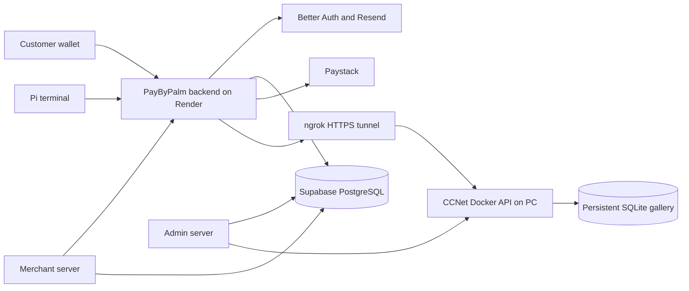

# PayByPalm

PayByPalm links a customer's palm to their account and saved payment card. At a
merchant terminal, the customer scans an enrolled palm, reviews the payer, card
and amount, then taps **Pay**. The backend requests the card charge and displays
success only after verifying the payment result.

The current implementation uses **CCNet for palm matching**, **Paystack or Flutterwave v3 for card
payments**, **Better Auth for accounts and sessions**, and **Supabase PostgreSQL
for application data**. The Raspberry Pi runs the terminal interface; the CCNet
model runs separately on a PC in Docker, exposed to the backend through ngrok.

This is a prototype under active development. The current matching thresholds
are provisional, and real Pi performance, biometric error rates and liveness
protection have not been established for production deployment. This README
describes the code in this checkout; publishing and deploying it are separate steps.

Card payments are selected with `PAYMENT_PROVIDER=paystack|flutterwave` (Paystack
by default). Cards, defaults and recovery stay separate by provider and test/live
mode. See the [payment provider deployment and switching guide](backend/PAYMENT_PROVIDERS.md)
for migration 0031, Render settings, Flutterwave NOAUTH approval, merchant subaccounts
and card relinking. Flutterwave uses a ₦100 card-verification payment; Paystack
retains ₦50. Both request a refund after successful verification.

## Contents

- [Applications and architecture](#applications-and-architecture)
- [Enrollment and checkout](#enrollment-and-checkout)
- [Matching policy](#matching-policy)
- [Local development](#local-development)
- [Deployment](#deployment)
- [Starting the reader and Pi](#starting-the-reader-and-pi)
- [Operations dashboard](#operations-dashboard)
- [Ratings and comments](#ratings-and-comments)
- [Security and data handling](#security-and-data-handling)
- [Validation](#validation)
- [Limitations and proposed work](#limitations-and-proposed-work)
- [Documentation](#documentation)

## Applications and architecture

| Component | Source | Responsibility | Deployment target |
| --- | --- | --- | --- |
| Wallet | [`wallet/`](wallet/) | Accounts, card management, palm-enrollment consent and payment history | [www.paybypalm.app](https://www.paybypalm.app) · Vercel root `wallet` |
| Pi terminal | [`wallet/src/terminal/`](wallet/src/terminal/), [`pi/`](pi/) | Camera capture, sale confirmation and payment recovery | [Wallet `/terminal`](https://www.paybypalm.app/terminal) in Chromium kiosk mode |
| Backend | [`backend/`](backend/) | Authentication, enrollment, matching orchestration, card charges and reconciliation | [Render API health](https://paybypalm-backend.onrender.com/health) · root `backend` |
| Administrator app | [`admin/`](admin/) | Merchants, payout setup, terminal provisioning and live operations | [admin.paybypalm.app](https://admin.paybypalm.app) · Vercel root `admin` |
| Merchant workspace | [`merchant/`](merchant/) | Merchant-scoped reporting, payment and settlement views | [merchant.paybypalm.app](https://merchant.paybypalm.app) · Vercel root `merchant` |
| Application database | [`supabase/`](supabase/) | Profiles, bindings, transactions, card references and operation metadata | Supabase PostgreSQL |
| CCNet reader | [Separate repository](https://github.com/Ayodeji63/PayByPalm-CCNET) | Palm preprocessing, embeddings, template storage and gallery search | PC Docker service → fixed ngrok HTTPS address |



The Pi authenticates with its registered device key. Customer wallets use user
sessions. The backend holds the CCNet integration credential; the admin server
uses a separate monitor-only credential. Neither credential belongs in a browser
bundle or on the Pi.

The wallet uses React, TypeScript, Vite and Tailwind CSS, with MediaPipe hand
guidance and ZXing QR scanning. The backend uses Node.js, Express, TypeScript and
Zod. Admin and merchant apps have their own React clients and Express servers.

Tencent modules and enrollment history remain in the repository/database, but
Tencent is disabled as an active provider in this rollout. There is no automatic
fallback from CCNet to Tencent. `PALM_PROVIDER=mock` is available for simulated
local development; it does not perform biometric recognition.

## Enrollment and checkout

### Account and card setup

1. Create an account, verify its email through Resend, sign in and set a wallet PIN.
2. Link a card through Paystack's hosted checkout. The wallet shows the configured
   test/live mode and requires consent before the verification payment.
3. The backend verifies the payment before saving a reusable card authorization
   and requesting its verification-payment refund. Refund status remains visible.
4. Select an active saved card as the default payment card.

Ordinary sign-in opens **Home**. Card-link returns resume **Cards**, and card
updates keep the user there. Temporary account/session-refresh outages preserve
saved credentials and offer Retry; confirmed invalid sessions require sign-in.
Enrollment QR links also resume their workflow after a required sign-in.

Paystack does not provide the customer's bank-card balance. The wallet reports
that balance as unavailable rather than substituting an old ledger balance.
Current purchases debit the linked card directly; the historical internal ledger
is retained and is not the funding source for checkout.

### Palm enrollment

1. A registered terminal creates a short-lived enrollment session and displays its QR.
2. The signed-in customer scans the QR and claims that session for their account.
3. The Pi captures **three distinct frames** of the selected left or right palm.
   Captures preserve aspect ratio, cap the longest edge at 960 pixels and limit
   each JPEG to 512 KiB.
4. The backend validates ownership, expiry and retry state, then submits all three
   captures to CCNet using an opaque subject reference.
5. CCNet checks sample consistency, averages the three normalized embeddings into
   one normalized template, and persists that template in SQLite.
6. The backend completes the active CCNet binding and updates wallet enrollment status.

Rejected captures can be retaken in the same active session. An uncertain write
retries the original in-memory captures; it must not silently create a competing
registration. Retries and concurrent attempts are serialized in the database.

Users with only a historical Tencent binding need fresh CCNet enrollment. Accounts,
cards and Tencent history are preserved. Unlinking revokes the CCNet binding and
removes its reader templates; incomplete upstream cleanup is reported for retry.
Each account has at most one active binding per provider.

**Phone-camera palm enrollment is proposed, not implemented.** The phone currently
claims the QR session; the Pi captures the palm.

### Terminal checkout

The customer flow is **amount → automatic scan → payer/card review → Pay → receipt**.

1. The merchant enters an amount. The terminal prepares the camera and hand guidance.
2. After stable positioning, the Pi captures three frames, 100 ms apart, and submits
   the sharpest frame for matching.
3. The backend supplies active CCNet bindings as an eligible gallery and requests
   the top two candidates in **one 1:N search**.
4. A qualifying match is bound to the exact active enrollment and displayed card.
   Binding, card, ownership and expiry checks remain required before charging.
5. The customer's **Pay** tap requests the charge. Identification alone never charges.
6. The backend verifies the provider result before committing payment confirmation.

A rejected palm offers another scan on the same unpaid sale. If a charge response
is uncertain, retain the original sale/transaction reference and recover its
status. Do not start another sale or clear recovery storage to repeat a charge.
A confirmed collection is distinct from the merchant's eventual bank settlement.

## Matching policy

| Setting or operation | Current behavior |
| --- | --- |
| CCNet 1:1 verification | Compares a probe with one claimed enrolled palm; standalone default threshold `0.50` |
| CCNet 1:N identification | Extracts one probe embedding and ranks the eligible templates; standalone default threshold `0.50` |
| Checkout score | `floor(100 × cosineSimilarity)`, clamped to `0–100` |
| Checkout acceptance | Positive reader verdict and a score of at least `max(50, PALM_ACCEPT_SCORE)`; current configured value is `50` |
| Candidate selection | Highest raw cosine similarity wins; a lower second candidate above the threshold does not disqualify it |
| Exact cross-user tie | Requires a retake; no payer is selected |
| Enrollment consistency | Reader default minimum pair similarity `0.50` across the three samples |
| `PALM_STEP_UP_SCORE=40` | Legacy policy band; does not authorize CCNet checkout below `50` |

Checkout uses 1:N identification; the adapter's 1:1 operation is available for
claimed-palm verification. Checkout does not make one comparison request per user.
The backend currently bounds the eligible list to 1,000 active bindings; this is
an application limit, not a measured SQLite capacity claim.

These scores are similarities, **not confidence percentages**. The current
thresholds were selected for testing, not derived from measured genuine/impostor
error rates. Calibrate on representative devices and lighting before production use.

## Local development

### Prerequisites

- Node.js 22.22 or a compatible runtime supported by the app manifests.
- Corepack and the pnpm version declared by each app's `packageManager` field.
- A Supabase project, PostgreSQL session-pooler connection and Supabase CLI.
- Resend credentials and a verified sending domain for account-email flows.
- Docker for isolated database tests and the real CCNet reader.
- For real matching: the separate CCNet checkout, its model assets and configured ngrok.

Each application has its own manifest and lockfile. Install from its directory;
there is no root command that starts every service.

```bash
git clone https://github.com/Ayodeji63/PayByPalm.git
cd PayByPalm
corepack enable
```

### 1. Prepare the database

For a **new development project**, review and apply migrations in filename order:

```bash
npx supabase login
npx supabase link --project-ref YOUR_PROJECT_REF
npx supabase db push
```

The current schema includes migration `0030`. Existing deployments require a
coordinated update: [authentication cutover](AUTH_MIGRATION.md) covers `0025/0026`;
[CCNet rollout](CCNET_ROLLOUT.md) covers `0027–0029`; [customer feedback](FEEDBACK.md)
covers `0030`. Preserve existing data and
migration records. Do not reset a hosted database or replay historical migrations
as an ordinary startup step.

### 2. Start the backend

From the repository root:

```bash
cd backend
pnpm install --frozen-lockfile
cp .env.example .env
pnpm auth:prepare
```

Copy the example only for initial setup. Configure `backend/.env` privately:

| Variables | Purpose |
| --- | --- |
| `SUPABASE_URL`, `SUPABASE_SERVICE_ROLE_KEY` | Application database access |
| `AUTH_DATABASE_URL` | PostgreSQL session-pooler URI for Better Auth |
| `AUTH_SECRET` | Persistent secret generated by `auth:prepare`; preserve existing values |
| `AUTH_BASE_URL` | Local API origin, normally `http://localhost:8080` |
| `RESEND_API_KEY`, `RESEND_FROM_EMAIL` | Verification and recovery email delivery |
| `WALLET_BASE_URL` | Local wallet origin, normally `http://localhost:5173` |
| `EXTRA_CORS_ORIGINS` | Additional exact browser origins, if needed |
| `PALM_PROVIDER` | `mock` for simulated development, `ccnet` for real matching |
| `CCNET_BASE_URL`, `CCNET_API_KEY` | Reader origin and dedicated server credential when using CCNet |
| `PAYSTACK_MODE` | Use `test` in a new development environment |
| `PAYSTACK_SECRET_KEY`, `CARD_TOKEN_ENCRYPTION_KEY` | Required for card-linking/payment tests; keep private |

The mock replaces only biometric calls. Accounts still require the configured
authentication database, and card flows require their own payment configuration.
Preserve the existing encryption key when using a database with saved cards.

```bash
pnpm auth:preflight
pnpm dev
```

The API defaults to `http://localhost:8080`. `/health` checks the application
database; the authentication preflight checks the separate PostgreSQL connection.

### 3. Start the wallet

In another terminal, from the repository root:

```bash
cd wallet
pnpm install --frozen-lockfile
cp .env.example .env
```

Set `VITE_API_BASE_URL=http://localhost:8080` in `wallet/.env`, then run:

```bash
pnpm dev
```

Open `http://localhost:5173`. Phone camera access requires HTTPS or a browser's
trusted loopback context; a phone opening a plain HTTP LAN address is not equivalent
to localhost. On a phone or Pi, `localhost` refers to that device.

### 4. Optional admin and merchant apps

Configure each app from its own `.env.example`, including its private server
settings and access grants. Then run `pnpm install --frozen-lockfile` and
`pnpm dev` from `admin/` or `merchant/`.

- Admin web: `http://127.0.0.1:5190`; local server port `8090`.
- Merchant web: `http://127.0.0.1:5193`; local server port `8093`.

See the [admin guide](admin/README.md) for merchant/device provisioning and the
[merchant guide](merchant/README.md) for account grants and reporting rules.

## Deployment

Deploy the wallet, admin and merchant as separate Vercel projects with the root
directories in the architecture table. Deploy the backend through
[`render.yaml`](render.yaml). The reader remains on the PC for the current setup.

Production backend configuration includes:

```dotenv
PALM_PROVIDER=ccnet
WALLET_BASE_URL=https://www.paybypalm.app
EXTRA_CORS_ORIGINS=https://paybypalm.app,https://pay-by-palm.vercel.app
CCNET_BASE_URL=https://YOUR_FIXED_NGROK_ADDRESS
CCNET_MATCH_TIMEOUT_MS=5000
CCNET_ENROLL_TIMEOUT_MS=20000
PALM_ACCEPT_SCORE=50
PALM_STEP_UP_SCORE=40
ENROL_SESSION_TTL_SECONDS=300
AUTH_VALIDITY_SECONDS=60
```

Set `CCNET_API_KEY` privately on Render, together with the existing database,
authentication, email and payment settings. The wallet build uses
`VITE_API_BASE_URL=https://paybypalm-backend.onrender.com`. Admin/merchant servers
use their documented backend URL and private settings; the admin also needs its
separate CCNet monitor credential.

`WALLET_BASE_URL` controls email, enrollment and card-checkout return links. Use
one canonical wallet origin. Different hostnames have separate browser login
storage; allowing both through CORS does not share sessions between them. Preserve
the old Vercel origin while existing Pi configurations still use it.

Save/redeploy the relevant hosting service after changing its environment. Local
`.env` edits do not change Render or a deployed frontend. Coordinate backend,
wallet/terminal and schema changes as described in the rollout guides. Preserve
existing Paystack mode, credentials and card encryption keys during normal releases.
Live mode charges real cards only through an explicitly authorized user action;
automated checks must use fixtures or test mode.

## Starting the reader and Pi

After the CCNet repository's initial setup, run from **that repository** on the PC:

```bash
python3 scripts/local.py start
python3 scripts/local.py status
```

The helper starts Docker, warms the reader, reuses the persistent SQLite volume,
waits for readiness and starts the fixed HTTPS tunnel with ngrok request inspection
disabled. SQLite is an embedded file: there is **no separate SQLite server to start**.
The PC must remain awake and online. Check reader readiness locally and through
the reported tunnel URL before starting enrollment.

On the Pi, from its logged-in graphical desktop:

```bash
bash ~/.local/share/paybypalm/pi/start-kiosk-session.sh
systemctl --user status paybypalm-kiosk.service --no-pager
```

The kiosk uses `~/.config/paybypalm/terminal.env` and its registered device key.
Provision once through the admin workflow or Pi provisioning helper; do not
regenerate keys on every restart or put them in a `?k=` URL. Preserve the browser
profile and pending-sale recovery data.

Use `python3 scripts/local.py stop` in the CCNet checkout to stop its managed
service/tunnel while preserving data. Never use `docker compose down -v` as a
restart command: it removes the enrolled-template volume.

Follow the [complete shutdown-to-startup walkthrough](https://github.com/Ayodeji63/PayByPalm-CCNET/blob/main/docs/START_AFTER_SHUTDOWN.md)
for PC, reader, tunnel, Render checks, dashboard, Pi and troubleshooting. Pi
installation and the optional 12-LED WS2812 ring are documented in
[pi/README.md](pi/README.md) and [pi/LEDS.md](pi/LEDS.md).
[Terminal audio guidance](pi/AUDIO.md) maps the 15 supplied recordings to capture,
positioning and payment events. Only a verified payment plays `success1.wav`.

## Operations dashboard

The admin operations monitor combines backend activity with CCNet reader metadata.
The main list shows important capture, enrollment, matching and payment outcomes,
with **10 events per page**. Details opens above the list and shows available
frame counts, candidate similarities, timing and a collapsed technical trace.

- **Palm captured** records a completed three-frame capture burst.
- **Palm accepted** means checkout authentication passed; no charge is implied.
- **Cancelled** records cancellation and is not presented as payment success.
- **Payment confirmed** receives the green success state only for a verified payment.

Reader processing completion is separate from identity acceptance and payment
confirmation. The monitor exposes metadata, not palm images, card secrets or API
keys. It is a bounded operational view, not a replacement for transaction records
or provider reconciliation.

## Ratings and comments

Customers can submit a 1–5 star rating and comment from their wallet Profile.
Feedback is private by default; administrators choose reviews to publish or
unpublish in **Admin → Feedback**. Public reviews appear on the welcome page
without account details. Customer edits remove publication until another review.
See [FEEDBACK.md](FEEDBACK.md) for migration 0030, API behavior and moderation.

## Security and data handling

- User sessions and terminal device credentials have separate authentication paths.
  The backend resolves account ownership; a terminal cannot choose an arbitrary payer.
- Application database credentials, auth/email secrets, CCNet keys and card-token
  encryption keys stay on trusted servers. Pi configuration contains its device key only.
- Captures are processed temporarily. Browser buffers are cleared after completion
  or cancellation; uncertain enrollment retries retain their original buffers in memory.
  CCNet persists templates and metadata rather than uploaded photographs.
- PostgreSQL stores provider-specific enrollment bindings and payment/audit records;
  local SQLite stores CCNet templates and reader-operation metadata. Both require
  controlled access and appropriate backup/deletion handling.
- The exact active binding, card, terminal ownership and authentication expiry are
  checked before a charge claim. Revocation/replacement prevents new stale claims.
- Durable sale IDs, charge claims and provider references protect retries. An
  uncertain charge remains recoverable; a successful HTTP request alone is not payment.
- API input limits, database-backed request budgets and audit/error classification
  are implemented. The CCNet service separately enforces scoped access and resource limits.

Camera hand guidance and a three-frame burst do **not** establish biometric liveness.
See [API controls](backend/SECURITY_API.md), [payment controls](backend/SECURITY_PAYMENTS.md)
and [authentication migration](AUTH_MIGRATION.md) for implementation details.

## Validation

Run commands from their respective application directories:

```bash
# backend/
pnpm typecheck
pnpm test
pnpm build

# wallet/
pnpm test:security
pnpm typecheck
pnpm build
pnpm guard:secrets

# admin/ and merchant/, independently
pnpm test
pnpm build
pnpm guard:secrets
```

From the repository root, `bash supabase/tests/run.sh` exercises isolated
PostgreSQL schema/payment invariants, including the CCNet migration/race suite.
`pnpm test:auth:database` in `backend/` checks the authentication cutover in a
disposable database. These checks require Docker and use test fixtures.

Browser checks cover auth/card returns, capture retakes, operations pagination and
payment-status presentation. See the app manifests and guides for server/Playwright
requirements: wallet `test:auth:browser` and `test:retake:browser`; admin
`test:operations:browser`. They intercept API responses and do not charge live cards.

A passing automated suite does not establish real-camera recognition accuracy,
liveness, live card collection, refunds or merchant bank settlement.

## Limitations and proposed work

- The current reader setup targets one Pi and fewer than 50 users. Higher-volume
  operation and the backend's 1,000-binding cap need separate capacity evaluation.
- Phone enrollment followed by Pi checkout needs cross-device accuracy and spoofing
  evaluation before enabling it for payments. Phone-camera enrollment is not shipped.
- The optional WS2812 ring currently uses fixed capture brightness. Adaptive
  camera/sensor-controlled lighting is proposed, not implemented.
- Local matching p95 ≤300 ms and stable-palm-to-Pay-screen p95 ≤1.5 s are targets,
  not verified end-to-end Pi results. Earlier local inference timing excludes capture,
  upload, tunnel and payment-provider time. Faster-than-NFC payment is not established.
- PC sleep, network/tunnel loss and ngrok quotas can make the reader unavailable.
  There is no offline payment authorization or automatic Tencent fallback.
- Paystack collection confirmation and eventual merchant settlement are distinct.
  The application cannot guarantee bank confirmation time.

## Documentation

| Topic | Guide |
| --- | --- |
| Current reader integration, API flow and rollout | [CCNET_ROLLOUT.md](CCNET_ROLLOUT.md) |
| Accounts, migration and email delivery | [AUTH_MIGRATION.md](AUTH_MIGRATION.md) |
| Wallet setup, auth/card returns and deployment | [wallet/README.md](wallet/README.md) |
| Administrator onboarding and device management | [admin/README.md](admin/README.md) |
| Merchant access and reporting | [merchant/README.md](merchant/README.md) |
| Pi installation and illumination | [pi/README.md](pi/README.md), [pi/LEDS.md](pi/LEDS.md) |
| Database history and schema tests | [supabase/README.md](supabase/README.md) |
| Card linking and financial recovery | [CARD_LINKING.md](backend/CARD_LINKING.md), [TERMINAL_SALE_RECOVERY.md](backend/TERMINAL_SALE_RECOVERY.md) |
| Ratings, private comments and publication | [FEEDBACK.md](FEEDBACK.md) |
| Terminal speech and speaker setup | [pi/AUDIO.md](pi/AUDIO.md) |
| Reader HTTP API and authentication | [CCNet API guide](https://github.com/Ayodeji63/PayByPalm-CCNET/blob/main/docs/API.md) |

Older integration reports include retired Tencent, Supabase Auth and internal-ledger
flows. Use this README, the current rollout/auth guides and the running code for the
active CCNet architecture; historical reports are not deployment instructions.

## Team

- Olusanya Ayodeji
- Raji Mubarak

[Historical recorded demo](https://drive.google.com/file/d/1MOuOVUfxC5ENNYc7mOXj4nDjERYhAECG/view?usp=sharing)
