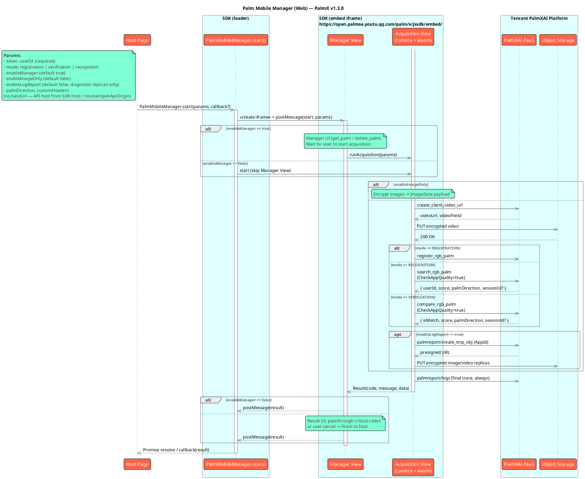

# Tencent Palm Recognition Mobile H5 SDK Reference (PalmX v1.3.0)

## Changelog

| Version | Release Date | Changes |
| :------ | :----------- | :------ |
| v1.3.0 | 2026-09-14 | Logging aligned with the new palmreport contract: **final-state trace (success / cancel / failure) is always reported**; `enableLogReport` only controls encrypted on-site image / video diagnostic replicas. Diagnostic media presigning migrated to `create_tmp_obj` (with `AppId` in the request body). Desktop browsers with landscape windows no longer cancel acquisition as orientation change |
| v1.2.0 | 2026-08-18 | `RecognitionData.sessionId`; `CheckAppQuality` on recognition / verification; **removed `Params.baseUrl`** (aligned with master H5: API host fixed by SDK Host deployment) |
| v1.1.0 | 2026-08-16 | PalmX Web SDK surface: `Params` / `Result` / `enableManager` / `enableImageOnly`; `VerificationData.sessionId`; manager direction constraints; `get_palm` `10021` → empty palms |
| v1.0.0 | 2026-07-20 | Initial PalmX line |

> Full notes: [CHANGELIST.md](./CHANGELIST.md).

## Introduction

The Tencent Palm Mobile Manager Web SDK is the **Web platform implementation** of PalmX palm biometrics. It supports **registration**, **verification (1:1)**, and **recognition (1:N)**. Capture and inference run in the browser via `iframe` + WebAssembly. The SDK is deployed on a dedicated SDK Host domain; host pages integrate with a single `<script src>` tag or the npm package.

### Core Modules

The SDK consists of two core modules: **Management Module** and **Acquisition Module**.

#### Management Module

**Palm management UI** (`enableManager = true`, default):

* **Palm state** — Query left/right registration via `get_palm`; support deleting registered palms
* **Business flow** — Registration, Recognition (1:N), Verification (1:1)
* **UI interaction** — Guidance, results, errors, and retry
* **Result handling** — Shows acquisition results inside the SDK; most business errors stay in-SDK for retry
* **Result callback** — Calls back to the host mainly on critical errors (invalid params, token invalid, gateway auth failure, user not found) or user exit

> The PalmX management module does **not** create users inside the SDK (no `userName` / `phoneNo` / `appId` params). Users must already exist on PalmXAI Platform; tokens are issued via `CreateSdkUserToken`.

#### Acquisition Module

**Palm print acquisition** (entered directly when `enableManager = false`; also used internally by the management module):

* **Camera** — `navigator.mediaDevices.getUserMedia` live preview
* **AI** — Detection, quality, liveness (WebAssembly)
* **Guidance** — Open-palm / fist prompts
* **Upload** — AES-128-GCM encrypted images; liveness video is recorded and uploaded by default. Client capture failure → `ErrLivenessVideoCaptureFailed (10105)`; server rejection → `ErrLivenessVideoFailed (10102)`; upload / network failure → `ErrNetwork (10500)`
* **Image-only** — `enableImageOnly = true` skips video upload and cloud register / search / compare, returning encrypted `ImageData`
* **Log reporting** — The final-state trace (success / cancel / failure) of every session is **always** reported to the palmreport log channel for statistics and troubleshooting; `enableLogReport = true` additionally uploads encrypted on-site image / video diagnostic replicas (see `Params.enableLogReport`)
* **Orientation** — Rotating a touch mobile device to landscape invalidates the current acquisition (treated as `10002` user cancel); desktop browser window orientation does not affect acquisition

### Features

* **Multiple modes** — Registration, Verification (1:1), Recognition (1:N)
* **Optimized AI** — Detection & alignment, liveness, quality, and action recognition via WebAssembly
* **Modular UI** — Pre-built Vue UI for manager and acquisition
* **Origin isolation** — Capture UI and wasm run in an iframe on an independent origin; `postMessage` with strict origin checks
* **Secure by design** — Palm data encrypted before upload; tokens must be server-issued — never hard-code platform secrets in the browser

### Glossary / Core Concepts

* **[Palm] Single-Factor Feature Set** — Palm print only. Browser cameras cannot capture palm vein; this SDK collects palm print only.
* **[Palm + PalmVein] Dual-Factor Feature Set** — Palm print + palm vein for professional-device enrollment. This Web SDK does not collect palm vein.

## SDK Host

The SDK is deployed by the service provider on a dedicated domain (SDK Host). Host pages include the loader via `<script src>`. The capture iframe, wasm, and camera UI are served by the SDK Host — **the host page does not need to know their internals**.

- `https://open.palmoa.youtu.qq.com/palm/x/jssdk/loader/palm-mobile-manager.js` — entry for `<script src>`
- `https://open.palmoa.youtu.qq.com/palm/x/jssdk/embed/` — capture iframe page (loader infers this from its own `<script src>`)

> **Important**: The SDK Host MUST be on a **different origin** from your host page so that `MessageEvent.origin` checks meaningfully secure cross-window communication. Loader and embed live on the same SDK Host.

## Workflow

### 1. Obtain User Token

Your backend requests a short-lived token bound to the end-user `UserId` from **Tencent PalmXAI Platform** (`CreateSdkUserToken`), then delivers it to the client.

```
Your Browser --[UserId]--> Your Server --[CreateSdkUserToken]--> Tencent PalmXAI Platform
Your Browser <--[Token]-- Your Server <--[Token]-- Tencent PalmXAI Platform
```

> The demo app (`packages/palm-x-ai`) shows token fetch for local testing. **Production** tokens must come from your backend — never put the platform `api_key` in front-end code.

### 2. Start the SDK

| SDK Module | Description |
| :--- | :--- |
| **Management** | `enableManager = true` (default). Shows manager UI, then acquisition; most results handled in-SDK |
| **Acquisition** | `enableManager = false`. Direct camera capture; host dispatches the full `Result` |

Call `PalmMobileManager.start` with `token` and `userId`.

### 3. Automated Flow

The **Management Module** queries palm state, shows guidance / result pages, runs acquisition by mode, and prompts retry in-SDK.

The **Acquisition Module** returns the full `Result` (including success `data`) via Promise / callback when done.

### 4. Receive Callback

Only one session at a time; concurrent calls are rejected immediately with `ErrSdkRuntime (10007)`.

- **Management**: host mainly receives user exit (`10002`) and critical passthrough codes (see Callback Result Codes). Success business payloads usually stay in the SDK result UI.
- **Acquisition**: host must handle the complete result-code set.

## Runtime Requirements

| Item | Requirement |
| :--- | :--- |
| **Protocol** | HTTPS (`localhost` excepted). `getUserMedia` requires a secure context. |
| **Browser** | ● Desktop: Chrome / Edge ≥ 88, Firefox ≥ 90, Safari ≥ 14<br/>● Mobile: iOS Safari ≥ 14, Android Chrome ≥ 88<br/>● Required: `MediaDevices.getUserMedia`, `postMessage`, ES2020, WebAssembly |
| **iframe permissions** | SDK sets `allow="camera; microphone"` on the iframe. Nested host iframes must allow camera at each level. |
| **Node (local / npm)** | Node.js ≥ 18; pnpm ≥ 9 |

## Integration Steps

### Prerequisites

1. **SDK Host URL** — production host `https://open.palmoa.youtu.qq.com`, assets under `/palm/x/jssdk/`.
2. **HTTPS** — both SDK Host and host page (except `localhost`).
3. **User & Token** — end user provisioned on the platform; backend issues token via `CreateSdkUserToken`.

> `packages/palm-x-ai` is a demo host only. Production tokens must be issued by your backend.

### `<script>` Integration

1. **Include the Loader**

    ```html
    <script src="https://open.palmoa.youtu.qq.com/palm/x/jssdk/loader/palm-mobile-manager.js"></script>
    ```

    The UMD build exposes under `window.PalmMobileManager`: the `PalmMobileManager` class, plus `Mode` / `PalmDirection` / `ResultCode`.

2. **Minimal example**

    ```html
    <script>
      const { PalmMobileManager, Mode } = window.PalmMobileManager;

      const params = {
        token: USER_TOKEN,
        userId: USER_ID,
        // mode: Mode.Registration,           // default registration
        // mode: 'verification',              // verification: userId is 1:1 compare target
        // palmDirection: 'palm_direction_unspecified',
        // enableManager: true,               // false = direct acquisition
        // enableImageOnly: false,
        // enableLogReport: false,            // true = upload encrypted diagnostic replicas
        // customHeaders: { Authorization: 'YOUR_JWT_TOKEN' },
      };

      PalmMobileManager.start(params, (r) => {
        console.log('[PalmMobileManager]', r);
      }).then((result) => {
        console.log('final:', result);
      });
    </script>
    ```

    > **Zero config**: the loader uses its own `<script src>` origin as the embed site. As long as loader and embed share the SDK Host, the host page needs no extra setup.

### npm

```bash
pnpm add palm-mobile-manager
```

```ts
import { PalmMobileManager, Mode, PalmDirection } from 'palm-mobile-manager';

const result = await PalmMobileManager.start({
  token: USER_TOKEN,
  userId: USER_ID,
  // mode: Mode.Verification,
  // palmDirection: PalmDirection.Left,
  // enableManager: false,
});

console.log(result);
```

Examples: `packages/palm-mobile-manager/example`, `packages/palm-x-ai`.

### Local Integration Testing

Option 1: **Point at the production SDK Host** (simplest). The host page may run on `http://localhost`; the camera is opened by the SDK Host HTTPS iframe:

```html
<script src="https://open.palmoa.youtu.qq.com/palm/x/jssdk/loader/palm-mobile-manager.js"></script>
```

Option 2: **Fully local SDK** (`make dev`, in-repo development). Starts a local SDK Host (:5173) and the Example app (:8000); the Example dev server same-origin proxies loader / embed / wasm and `/palm/openai/*`, and can issue test tokens locally with `PALM_API_KEY` (the Api Key stays in the local server process and is never delivered to the browser):

```bash
cd apps/palm-client
PALM_API_KEY='ak_xxx' make dev   # auto-creates a token when PALM_API_KEY/PALM_USER_ID are set
```

Open the Example page, enter a UserId, and click "Get Token & Start SDK". See `packages/palm-mobile-manager/example/README.md`.

## API Reference

### `PalmMobileManager.start(params, callback?)`

Starts one management / acquisition session and returns `Promise<Result>`. `callback` and `Promise` receive the same `Result`. Only one session at a time; concurrent calls return `ErrSdkRuntime (10007)`.

| Positional | Type | Required | Description |
| :--- | :--- | :---: | :--- |
| `params` | `Params` | ✅ | See below |
| `callback` | `(result: Result) => void` |  | Optional; Promise still resolves with the same result |

### `PalmMobileManager.back()`

Sends a back command to the active embed (same semantics as the in-UI back control). No-op if no session.

### `PalmMobileManager.version`

Static string, currently `0.0.1` (package version). Product-line version is **v1.3.0** per this document / CHANGELIST.

### Params

> Startup validates non-empty fields; failure returns `code=10001`. Prefer the `userId` format below; otherwise the backend may map to `10018`.

#### Required Parameters

| Parameter | Type | Description |
| :--- | :--- | :--- |
| `token` | `string` | User identity token (issued by backend `CreateSdkUserToken`). |
| `userId` | `string` | Unique user id.<br/>• `registration`: user to enroll<br/>• `verification`: 1:1 compare target (`CompareUserId`)<br/>• `recognition`: still required by validation, not used as 1:N search target<br/>**Recommended format**: 1–64 chars, `[A-Za-z0-9_-]` only, no whitespace. |

#### Optional Parameters

| Parameter | Type | Default | Description |
| :--- | :--- | :--- | :--- |
| `mode` | `Mode` | `Registration` (`'registration'`) | • `Mode.Registration` (`'registration'`)<br/>• `Mode.Verification` (`'verification'`)<br/>• `Mode.Recognition` (`'recognition'`) |
| `palmDirection` | `PalmDirection` | `Unspecified` | • `PalmDirection.Unspecified` (`'palm_direction_unspecified'`)<br/>• `PalmDirection.Left` (`'left'`)<br/>• `PalmDirection.Right` (`'right'`) |
| `enableManager` | `boolean` | `true` | `true` = management module; `false` = acquisition only. |
| `enableImageOnly` | `boolean` | `false` | When `true`, return encrypted `ImageData` only — no video upload, no register / search / compare. |
| `enableLogReport` | `boolean` | `false` | When `true`, additionally upload **AES-128-GCM encrypted** on-site image / video diagnostic replicas (presigned via `create_tmp_obj`, uploaded directly to object storage) for troubleshooting. **The final-state trace log is not gated by this switch and is always reported** (statistics baseline). |
| `customHeaders` | `Record<string, string>` | `{}` | Extra HTTP headers (e.g. gateway JWT). |

> **Difference vs. native (H5 characteristic)**: The Web SDK **does not expose `baseUrl`**. The API endpoint is decided by the embed / SDK Host at deployment time: same-origin relative `/palm/*` via Ingress / reverse proxy by default; when the page host is `app.*`, the SDK rewrites to matching `open.*`. The host page cannot override it. To connect to a different backend environment, deploy the corresponding SDK Host.
>
> **vs older PalmX docs**: no `userName` / `phoneNo` / `appId` / `targetUserId`. Verification target is `userId`.

### Result

```ts
interface Result {
  code: number;
  message: string;
  data?: RegistrationData | RecognitionData | VerificationData | ImageData;
  traceId?: string;
}
```

| Property | Type | Description |
| :--- | :--- | :--- |
| `code` | `number` | Result code (see below). |
| `message` | `string` | Debug message. |
| `data` | `ResultData` \| `undefined` | Success payload; shape depends on `mode` / `enableImageOnly`. |
| `traceId` | `string` \| `undefined` | Request trace id (may be present on failure). |

#### ResultData

```ts
interface RegistrationData {
  userId: string;
}

interface RecognitionData {
  userId: string;
  score: number;
  palmDirection?: PalmDirection;
  /** Temporary search-result lookup credential (SearchRgbPalmRsp.SessionId, ~2h TTL) */
  sessionId?: string;
}

interface VerificationData {
  isMatch: boolean;
  score: number;
  palmDirection?: PalmDirection;
  /** Temporary compare-result lookup credential (CompareRgbPalmRsp.SessionId, ~2h TTL) */
  sessionId?: string;
}

interface ImageData {
  /** Serialized acquisition JSON (image fields AES-128-GCM encrypted) */
  payload: string;
}
```

#### Callback Result Codes (Management Module)

With `enableManager = true`, the host **mainly** receives:

| Code | Scenario | Suggested action |
| :--- | :--- | :--- |
| `10002` | User exit (e.g. back from manager root) | Treat as cancel |
| `10001` | Invalid parameters | Validate required fields / `mode` |
| `10012` | Token invalid or expired | Re-issue token |
| `10021` | User does not exist (passthrough) | Check user / re-login |
| `10401` | Gateway auth failure | Check gateway JWT / contact SDK Host provider |

> Token / gateway auth failures may **immediately** `finish` via the request interceptor. Successful business payloads stay in the manager result UI by default; use `enableManager = false` if the host needs the full success `data`.

#### Complete Result Code Reference

> **Acquisition module** (`enableManager = false`) does not swallow codes — the host must dispatch the full set:

<details>
<summary>Expand all result codes</summary>

##### Common

| Code | Enum | Notes |
| :--- | :--- | :--- |
| 0 | `Success` | Success |
| 10000 | `ErrUnknown` | Unknown error |
| 10001 | `ErrInvalidParams` | Invalid parameters (**manager callbacks**) |
| 10002 | `ErrUserCancelled` | User cancelled (**manager callbacks**) |
| 10003 | `ErrCameraPermissionDenied` | Camera permission denied |
| 10004 | `ErrCameraInitFailed` | Camera init failed |
| 10005 | `ErrCameraPreviewUnsupported` | Unsupported preview size |
| 10006 | `ErrSdkInitFailed` | SDK / wasm init failed |
| 10007 | `ErrSdkRuntime` | Runtime error (incl. concurrent session) |
| 10008 | `ErrAcquisitionTimeout` | Acquisition timeout (30s) |
| 10012 | `ErrUserTokenInvalid` | Token invalid/expired (**callback / may exit immediately**) |
| 10016 | `ErrLicenseValidationFailed` | License validation failed |
| 10018 | `ErrUserIdInvalid` | Invalid user id format |
| 10020 | `ErrAppDisabled` | App disabled |
| 10021 | `ErrUserNotExist` | User not found (**manager callbacks**; manager `get_palm` treats as empty palms) |

##### Registration

| Code | Enum | Notes |
| :--- | :--- | :--- |
| 10100 | `ErrLivenessFailed` | Liveness failed |
| 10101 | `ErrQualityFailed` | Quality failed |
| 10102 | `ErrLivenessVideoFailed` | Liveness video rejected by server |
| 10103 | `ErrAlreadyBind` | Palm already registered |
| 10104 | `ErrHighSimilarity` | High similarity with existing user |
| 10105 | `ErrLivenessVideoCaptureFailed` | Client could not record liveness video (browser / insecure context / recorder lost) |

##### Recognition

| Code | Enum | Notes |
| :--- | :--- | :--- |
| 10200 | `ErrUserNotRecognized` | User not recognized |

##### Verification

| Code | Enum | Notes |
| :--- | :--- | :--- |
| 10300 | `ErrTargetUserNotFound` | Target user not found |
| 10301 | `ErrTargetUserUnregistered` | Target has no registered palm |
| 10302 | `ErrTargetUserPalmDirectionUnregistered` | Target missing current palm direction |

##### Network

| Code | Enum | Notes |
| :--- | :--- | :--- |
| 10401 | `ErrUnauthorized` | Gateway unauthorized (**callback / may exit immediately**) |
| 10500 | `ErrNetwork` | Network error (incl. unmapped backend codes) |

</details>

## Architecture

```
Host Page
  └─ PalmMobileManager.start(params, callback?)
       └─ <iframe src="https://open.palmoa.youtu.qq.com/palm/x/jssdk/embed/" allow="camera; microphone">
            └─ Manager View → Acquisition View
                 └─ getUserMedia + wasm + Tencent PalmXAI Platform
       ←── postMessage { ns:'palm-mobile-manager', v:1, msg:{ type:'result', payload } } ──
```

* Loader ↔ Embed enforce bidirectional origin checks.
* Cloud APIs (when not `enableImageOnly`): `register_rgb_palm` / `search_rgb_palm` / `compare_rgb_palm`; recognition and verification requests send `CheckAppQuality: true`.
* Log channel: the final-state trace (success / cancel / failure) is always reported to `/palm/openai/palm/palmreport/logs` (OTLP, `report_source=3`, `device_sn` is a browser-persistent random id). With `enableLogReport = true`, encrypted on-site image / video diagnostic replicas are additionally presigned via `/palm/openai/palm/palmreport/create_tmp_obj` (`AppId` in the request body) and uploaded directly to object storage. The SDK awaits the log queue before returning the result — destroying the iframe does not truncate the final trace.

<details>
<summary>Full sequence diagram (PlantUML)</summary>



</details>

## Security Warning

### Production Environment Security Requirements

**Never hard-code platform account secrets in production browser code.**

All calls that need platform secrets (e.g. `CreateSdkUserToken`) must run on your server. The browser only receives a short-lived token.

```
Browser --[UserId]--> Your Server --[CreateSdkUserToken]--> Tencent PalmXAI Platform
Browser <--[Token]-- Your Server <--[Token]-- Tencent PalmXAI Platform
```

### Session Uniqueness

Only one Web SDK session at a time. Concurrent `PalmMobileManager.start()` calls are rejected with `ErrSdkRuntime (10007)`.

### Quick Start for Testing Environments

For **local / internal / isolated demo** only. In production, tokens must be issued dynamically by your backend.

```html
<!DOCTYPE html>
<html lang="en">
<head>
  <meta charset="UTF-8" />
  <meta name="viewport" content="width=device-width, initial-scale=1.0, viewport-fit=cover" />
  <title>Palm H5 Test</title>
</head>
<body>
  <button id="startBtn">Start</button>
  <pre id="result"></pre>

  <script src="https://open.palmoa.youtu.qq.com/palm/x/jssdk/loader/palm-mobile-manager.js"></script>
  <script>
    // [TEST ONLY] do not embed production tokens in pages
    const USER_TOKEN = 'eyJhbGciOi...';
    const USER_ID = 'YourUserId';
    const MODE = 'registration'; // 'registration' | 'verification' | 'recognition'

    const { PalmMobileManager } = window.PalmMobileManager;
    const resultEl = document.getElementById('result');

    document.getElementById('startBtn').addEventListener('click', async () => {
      try {
        const result = await PalmMobileManager.start({
          token: USER_TOKEN,
          userId: USER_ID,
          mode: MODE,
          enableManager: false, // easier to observe full Result in tests
        });
        resultEl.textContent = JSON.stringify(result, null, 2);
      } catch (err) {
        resultEl.textContent = `Error: ${err?.code ?? ''} ${err?.message ?? err}`;
      }
    });
  </script>
</body>
</html>
```

## Next Steps & Support

* **Examples**: `packages/palm-mobile-manager/example`, `packages/palm-x-ai`
* **Deploy layout**: `deploy/README.md`
* **Support**: contact your technical support representative
