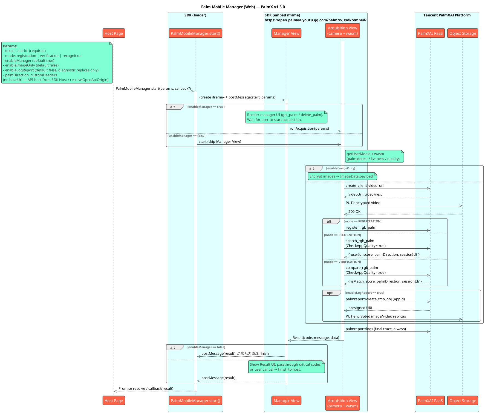

# 腾讯刷掌移动端（H5）SDK接口文档（PalmX v1.3.0）

## 版本更新记录

| 版本号 | 发布日期 | 更新内容 |
| :----- | :--------- | :------- |
| v1.3.0 | 2026-09-14 | 日志上报对齐 palmreport 新契约：**终态 trace（成功/取消/失败）始终上报**，`enableLogReport` 仅控制加密现场图/视频诊断副本；诊断媒体预签名迁移至 `create_tmp_obj`（请求体携带 `AppId`）；桌面浏览器横向窗口不再判定为横屏取消 |
| v1.2.0 | 2026-08-18 | `RecognitionData.sessionId`；识别 / 核验启用 `CheckAppQuality`；**移除 `Params.baseUrl`**（对齐 master H5：API 地址由 SDK Host 部署决定） |
| v1.1.0 | 2026-08-16 | 对齐 PalmX Web SDK 对外面：`Params` / `Result` / `enableManager` / `enableImageOnly`；`VerificationData.sessionId`；管理页方向约束与 `get_palm` `10021` → 空手掌 |
| v1.0.0 | 2026-07-20 | PalmX 线首发 |

> 完整变更说明见 [CHANGELIST.md](./CHANGELIST.md)。

## 简介

Tencent Palm Mobile Manager Web SDK 是 PalmX 掌纹生物识别能力的 **Web 平台实现**，支持**注册**、**核验 (1:1)**、**识别 (1:N)** 三种模式。采集与算法在浏览器内通过 `iframe` + WebAssembly 完成；SDK 部署在独立的 SDK Host 域名下，宿主页通过一行 `<script src>` 或 npm 包即可接入。

### 核心模块

SDK 由两大核心模块构成：**管理模块**与**采集模块**。

#### 管理模块

**掌纹管理引导页**（`enableManager = true`，默认），主要负责：

* **掌纹状态** — 查询左右手注册状态（`get_palm`），支持删除已注册手掌
* **业务流程** — 支持注册、识别 (1:N)、核验 (1:1) 三种模式入口
* **界面交互** — 展示操作引导、处理结果、错误提示与重试
* **结果处理** — 在 SDK 内展示采集结果；大部分业务错误留在 SDK 内重试
* **结果回调** — 仅在关键错误（参数非法、Token 失效、网关认证失败、用户不存在）或用户主动退出时回调宿主页

> PalmX 管理模块**不**负责在 SDK 内创建用户（无 `userName` / `phoneNo` / `appId` 入参）。用户须已由您的服务端在 PalmXAI Platform 侧就绪；Token 通过 `CreateSdkUserToken` 签发。

#### 采集模块

**手掌信息采集**（`enableManager = false` 时直入；管理模块内部也会调用同一套采集能力）：

* **相机采集** — 通过 `navigator.mediaDevices.getUserMedia` 唤起摄像头，提供实时预览
* **AI 处理** — 内置掌纹检测、质量评估、活体动作判断等算法能力（wasm 推理）
* **交互引导** — 引导用户完成「张开手掌」「握拳」等动作
* **数据上报** — 掌纹图像 AES-128-GCM 加密后上传；默认会采集并上传活体视频。客户端无法录制 → `ErrLivenessVideoCaptureFailed (10105)`；服务端判定视频不合格 → `ErrLivenessVideoFailed (10102)`；上传 / 网络失败 → `ErrNetwork (10500)`
* **仅图模式** — `enableImageOnly = true` 时跳过视频上传与云端 register / search / compare，直接返回加密后的 `ImageData`
* **日志上报** — 每次会话的终态 trace（成功 / 取消 / 失败）**始终**上报至 palmreport 日志通道，用于统计与排障；`enableLogReport = true` 时额外上传加密现场图 / 视频诊断副本（见 `Params.enableLogReport`）
* **方向约束** — 触屏移动设备转至横屏会作废本次采集（按 `10002` 用户取消处理）；桌面浏览器的窗口方向不影响采集

### 功能特性

* **多种模式**：支持**注册**、**核验 (1:1)**、**识别 (1:N)**。
* **优化的 AI 算法**：检测配准、活体判断、质量控制、动作判断经 WebAssembly 集成在 SDK 内。
* **模块化 UI**：管理引导页与采集页提供预构建 Vue UI。
* **Origin 隔离**：采集 UI 与 wasm 运行在独立源的 iframe 内，通过 `postMessage` + 严格 origin 校验与宿主页解耦。
* **安全设计**：掌纹数据上传前自动加密；Token 必须由服务端签发，禁止在前端硬编码平台密钥。

### 术语表 / 核心概念

* **【掌纹】单因子特征库**
  * **说明**：仅记录【掌纹】单因子信息。浏览器摄像头无法采集【掌静脉】，本 SDK 仅采集【掌纹】单因子信息。
* **【掌纹+掌静脉】双因子特征库**
  * **说明**：同时记录【掌纹】和【掌静脉】。用于专业设备录入的高安全标准；本 Web SDK 不采集掌静脉。

## SDK Host

SDK 由服务方部署在独立域名（SDK Host）下。宿主页通过一行 `<script src>` 引入该域名下的 loader 即可接入。采集所需的 iframe、wasm、摄像头 UI 全部由 SDK Host 自动加载与托管，**宿主页无需关心其内部构成**。

- `https://open.palmoa.youtu.qq.com/palm/x/jssdk/loader/palm-mobile-manager.js` —— 宿主页 `<script src>` 引入的入口
- `https://open.palmoa.youtu.qq.com/palm/x/jssdk/embed/` —— 采集 iframe 自动加载的页面（loader 会从自身 `<script src>` 推断地址，无需手动配置）

> **重要**：SDK Host 必须与您的宿主页处于**不同的 origin**，`postMessage` 的 `MessageEvent.origin` 校验才有意义。loader 与 embed 同处一个 SDK Host。

## 工作流程

### 1. 获取用户令牌

您的服务端必须首先从 **Tencent PalmXAI Platform** 请求与终端用户 `UserId` 绑定的短时 Token（`CreateSdkUserToken`），再下发给客户端。

```
您的浏览器 --[UserId]--> 您的服务端 --[调用 CreateSdkUserToken]--> Tencent PalmXAI Platform
您的浏览器 <--[Token]-- 您的服务端 <--[Token]-- Tencent PalmXAI Platform
```

> Demo 工程（`packages/palm-x-ai`）会演示 Token 获取；**生产环境**必须由您自己的后端签发，禁止把平台 `api_key` 写入前端。

### 2. 启动 SDK

| SDK 模块 | 说明 |
| :--- | :--- |
| **管理模块** | `enableManager = true`（默认）。展示管理引导页，用户交互后再进入采集；结果多在 SDK 内处理 |
| **采集模块** | `enableManager = false`。直入摄像头采集，宿主页自行根据完整 `Result` 分发业务 |

使用 `token` 与 `userId` 调用 `PalmMobileManager.start`。

### 3. 自动化流程

**管理模块**会自动完成：查询掌纹状态、展示引导与结果页、按模式调用采集、在 SDK 内提示重试。

**采集模块**采完即通过 `Promise` / `callback` 返回完整 `Result`（含成功时的 `data`）。

### 4. 获取回调

同一时刻只允许一个会话；并发调用会立即以 `ErrSdkRuntime (10007)` 拒绝。

- **管理模块**：宿主页主要收到用户退出（`10002`）与关键透传码（见下方「回调结果码」）；成功业务数据通常留在 SDK 结果页内展示。
- **采集模块**：宿主页需自行处理完整结果码表。

## 运行环境要求

| 项 | 要求 |
| :--- | :--- |
| **协议** | HTTPS（`localhost` 例外）。浏览器 `getUserMedia` 强制要求安全上下文。 |
| **浏览器** | ● 桌面：Chrome / Edge ≥ 88，Firefox ≥ 90，Safari ≥ 14<br/>● 移动：iOS Safari ≥ 14，Android Chrome ≥ 88<br/>● 必需能力：`MediaDevices.getUserMedia`、`postMessage`、ES2020、WebAssembly |
| **iframe 权限** | SDK 会自动在 iframe 上设置 `allow="camera; microphone"`。若宿主页自身位于第三方 iframe 内，需在外层逐级放行相机权限。 |
| **Node/构建**（仅本地开发 / npm 接入） | Node.js ≥ 18；pnpm ≥ 9 |

## 集成步骤

### 前置条件

1. **SDK Host 地址**：正式环境为 `https://open.palmoa.youtu.qq.com`，产物路径为 `/palm/x/jssdk/`。
2. **HTTPS**：SDK Host 与宿主页均需 HTTPS（`localhost` 例外）。
3. **用户与 Token**：终端用户已在平台侧就绪；由您的后端调用 `CreateSdkUserToken` 下发 Token。

> `packages/palm-x-ai` 仅用于联调演示；正式接入的 Token 仍须由您的后端签发。

### `<script>` 接入

1. **引入 Loader**

    ```html
    <!-- 生产：正式 SDK Host -->
    <script src="https://open.palmoa.youtu.qq.com/palm/x/jssdk/loader/palm-mobile-manager.js"></script>
    ```

    UMD 产物在 `window.PalmMobileManager` 命名空间下暴露：`PalmMobileManager` 类，以及 `Mode` / `PalmDirection` / `ResultCode`。

2. **简要调用示例**

    ```html
    <script>
      const { PalmMobileManager, Mode } = window.PalmMobileManager;

      const params = {
        token: USER_TOKEN,
        userId: USER_ID,
        // mode: Mode.Registration,           // 默认 registration
        // mode: 'verification',              // 核验：userId 为 1:1 比对目标
        // palmDirection: 'palm_direction_unspecified',
        // enableManager: true,               // false = 直入采集
        // enableImageOnly: false,
        // enableLogReport: false,            // true = 额外上传加密诊断副本
        // customHeaders: { Authorization: 'YOUR_JWT_TOKEN' },
      };

      PalmMobileManager.start(params, (r) => {
        console.log('[PalmMobileManager]', r);
      }).then((result) => {
        console.log('final:', result);
      });
    </script>
    ```

    > **零配置**：loader 以自身 `<script src>` 的 origin 作为 embed 站点地址。只要 loader 与 embed 部署在同一 SDK Host，宿主页无需额外配置。

### npm 接入

```bash
pnpm add palm-mobile-manager
```

```ts
import { PalmMobileManager, Mode, PalmDirection } from 'palm-mobile-manager';

const result = await PalmMobileManager.start({
  token: USER_TOKEN,
  userId: USER_ID,
  // mode: Mode.Verification,
  // palmDirection: PalmDirection.Left,
  // enableManager: false,
});

console.log(result);
```

示例：`packages/palm-mobile-manager/example`、`packages/palm-x-ai`。

### 本地联调

方式一：**指向正式 SDK Host**（最简）。宿主页 `<script src>` 直接指向正式环境，宿主页可跑在 `http://localhost`，摄像头由 SDK Host 的 HTTPS iframe 调起：

```html
<script src="https://open.palmoa.youtu.qq.com/palm/x/jssdk/loader/palm-mobile-manager.js"></script>
```

方式二：**全本地 SDK**（`make dev`，仓库内开发）。本地起 SDK Host（:5173）与 Example（:8000）；Example dev server 同源代理 loader / embed / wasm 与 `/palm/openai/*`，并提供 `PALM_API_KEY` 一键签发测试 Token（Api Key 只存在本机服务进程，不下发浏览器）：

```bash
cd apps/palm-client
PALM_API_KEY='ak_xxx' make dev   # 检测到 PALM_API_KEY/PALM_USER_ID 时自动预签发
```

打开 Example 页面输入 UserId，点击「获取 Token 并启动 SDK」即可。详见 `packages/palm-mobile-manager/example/README.md`。

## API 参考

### `PalmMobileManager.start(params, callback?)`

启动一次采集 / 管理流程，返回 `Promise<Result>`。`callback` 与 `Promise` 会拿到同一份 `Result`。同一时刻只允许一个会话；并发调用立即返回 `ErrSdkRuntime (10007)`。

| 位置参数 | 类型 | 必填 | 说明 |
| :--- | :--- | :---: | :--- |
| `params` | `Params` | ✅ | 业务参数，见下 |
| `callback` | `(result: Result) => void` |  | 可选回调；未传时 `Promise` 同样会 resolve 出同一份结果 |

### `PalmMobileManager.back()`

向当前会话的 embed 发送后退指令（与界面返回键同语义）。无进行中会话时为空操作。

### `PalmMobileManager.version`

静态字符串，当前为 `0.0.1`（包版本）。产品线版本以本文档 / CHANGELIST 的 **v1.3.0** 为准。

### Params

启动 SDK 时的配置参数对象。

> 提示：启动时仅做非空校验；不通过返回 `code=10001`。`userId` 推荐遵循下述格式，否则可能由后端映射为 `10018`。

#### 必填参数

| 参数 | 类型 | 描述 |
| :--- | :--- | :--- |
| `token` | `string` | 用户身份令牌，用于授权本次 SDK 操作（由后端 `CreateSdkUserToken` 签发）。 |
| `userId` | `string` | 用户唯一标识符。<br/>• `registration`：待注册用户<br/>• `verification`：1:1 比对目标用户（`CompareUserId`）<br/>• `recognition`：校验仍要求传入，但不作为 1:N 检索目标<br/>**推荐格式**：1–64 字符，仅 `[A-Za-z0-9_-]`，无空白。 |

#### 可选参数

| 参数 | 类型 | 默认值 | 描述 |
| :--- | :--- | :--- | :--- |
| `mode` | `Mode` | `Registration` (`'registration'`) | • `Mode.Registration` (`'registration'`) — 注册<br/>• `Mode.Verification` (`'verification'`) — 核验 (1:1)<br/>• `Mode.Recognition` (`'recognition'`) — 识别 (1:N) |
| `palmDirection` | `PalmDirection` | `Unspecified` | • `PalmDirection.Unspecified` (`'palm_direction_unspecified'`) — 任意手<br/>• `PalmDirection.Left` (`'left'`) — 强制左手<br/>• `PalmDirection.Right` (`'right'`) — 强制右手 |
| `enableManager` | `boolean` | `true` | `true` 启动管理模块；`false` 直入采集模块。 |
| `enableImageOnly` | `boolean` | `false` | `true` 时仅返回加密掌图 `ImageData`，不上传视频、不调用 register / search / compare。 |
| `enableLogReport` | `boolean` | `false` | `true` 时额外上传 **AES-128-GCM 加密**的现场图 / 视频诊断副本（经 `create_tmp_obj` 申请预签名 URL 后直传对象存储），用于问题排查。**终态 trace 日志不受此开关控制，始终上报**（统计基线）。 |
| `customHeaders` | `Record<string, string>` | `{}` | 自定义 HTTP 请求头（如网关 JWT）。 |

> **与 native 的差异（H5 特点）**：Web 版**不暴露 `baseUrl`**。API 服务地址由 embed / SDK Host 在部署时决定：默认同源相对路径 `/palm/*`（Ingress / 反向代理）；若页面 host 为 `app.*`，SDK 内部转写到同后缀 `open.*`。宿主页无法覆盖。若需连接不同环境的后端，请部署对应环境的 SDK Host。
>
> **与部分旧版 PalmX 文档的差异**：无 `userName` / `phoneNo` / `appId` / `targetUserId`。核验目标即为 `userId`。

### Result

SDK 退出时通过回调 / Promise 返回的结果对象。

```ts
interface Result {
  code: number;
  message: string;
  data?: RegistrationData | RecognitionData | VerificationData | ImageData;
  traceId?: string;
}
```

| 属性 | 类型 | 描述 |
| :--- | :--- | :--- |
| `code` | `number` | 结果码，详见下方结果码列表。 |
| `message` | `string` | 描述信息，仅用于调试。 |
| `data` | `ResultData` \| `undefined` | 成功时的详细结果数据，形态由 `mode` / `enableImageOnly` 决定。 |
| `traceId` | `string` \| `undefined` | 请求链路 ID（失败时可能返回，便于排障）。 |

#### ResultData

```ts
interface RegistrationData {
  userId: string;
}

interface RecognitionData {
  userId: string;
  score: number;
  palmDirection?: PalmDirection;
  /** 识别结果临时查询凭据（对齐 SearchRgbPalmRsp.SessionId，TTL 约 2 小时） */
  sessionId?: string;
}

interface VerificationData {
  isMatch: boolean;
  score: number;
  palmDirection?: PalmDirection;
  /** 比对结果临时查询凭据（对齐 CompareRgbPalmRsp.SessionId，TTL 约 2 小时） */
  sessionId?: string;
}

interface ImageData {
  /** 序列化后的采集 JSON（图片字段已 AES-128-GCM 加密） */
  payload: string;
}
```

#### 回调结果码（管理模块）

**管理模块会自动处理采集中的大部分结果**。宿主页在 `enableManager = true` 时，**主要会收到以下结果码**：

| 结果码 | 场景 | 处理建议 |
| :--- | :--- | :--- |
| `10002` | 用户主动退出（管理页根路径返回等） | 按取消处理 |
| `10001` | 参数非法 | 校验必填项与 `mode` 等 |
| `10012` | Token 无效或过期 | 重新获取 Token |
| `10021` | 用户不存在（透传） | 提示核对用户 / 重新登录 |
| `10401` | 网关认证失败 | 检查网关 JWT / 联系 SDK Host 提供方 |

> Token / 网关鉴权失败时，SDK 可能在请求拦截器中**立即** `finish` 退出，不等待用户点击。成功业务结果默认留在管理模块结果页；若宿主需要拿到完整成功 `data`，请使用采集模块（`enableManager = false`）。

#### 完整结果码参考

> **说明**：**采集模块**（`enableManager = false`）不会吞掉结果码，宿主页需自行分发。完整结果码如下：

<details>
<summary>点击展开查看所有结果码</summary>

##### 通用结果码

| 结果码 | 枚举 | 开发说明 |
| :--- | :--- | :--- |
| 0 | `Success` | 操作成功 |
| 10000 | `ErrUnknown` | 未知错误 |
| 10001 | `ErrInvalidParams` | 参数无效（**管理模块会回调**） |
| 10002 | `ErrUserCancelled` | 用户取消（**管理模块会回调**） |
| 10003 | `ErrCameraPermissionDenied` | 相机权限被拒绝 |
| 10004 | `ErrCameraInitFailed` | 相机初始化失败 |
| 10005 | `ErrCameraPreviewUnsupported` | 不支持的相机预览尺寸 |
| 10006 | `ErrSdkInitFailed` | SDK 初始化失败（含 wasm） |
| 10007 | `ErrSdkRuntime` | SDK 运行时错误（含「另一个会话进行中」） |
| 10008 | `ErrAcquisitionTimeout` | 采集超时（30 秒） |
| 10012 | `ErrUserTokenInvalid` | Token 无效或已过期（**会回调 / 可能立即退出**） |
| 10016 | `ErrLicenseValidationFailed` | 授权证书验证失败 |
| 10018 | `ErrUserIdInvalid` | 用户 ID 格式不正确 |
| 10020 | `ErrAppDisabled` | 应用被禁用 |
| 10021 | `ErrUserNotExist` | 用户不存在（**管理模块会回调**；管理页 `get_palm` 命中时按空手掌处理） |

##### 注册模式结果码

| 结果码 | 枚举 | 开发说明 |
| :--- | :--- | :--- |
| 10100 | `ErrLivenessFailed` | 活体检测失败 |
| 10101 | `ErrQualityFailed` | 质量检查失败 |
| 10102 | `ErrLivenessVideoFailed` | 活体视频验证失败（服务端判定） |
| 10103 | `ErrAlreadyBind` | 该手掌已注册 |
| 10104 | `ErrHighSimilarity` | 与已有用户高度相似 |
| 10105 | `ErrLivenessVideoCaptureFailed` | 客户端本地活体视频录制失败（浏览器不支持 / 非安全上下文 / recorder 失活） |

##### 识别模式结果码

| 结果码 | 枚举 | 说明 |
| :--- | :--- | :--- |
| 10200 | `ErrUserNotRecognized` | 用户未识别 |

##### 核验模式结果码

| 结果码 | 枚举 | 说明 |
| :--- | :--- | :--- |
| 10300 | `ErrTargetUserNotFound` | 待验证用户不存在 |
| 10301 | `ErrTargetUserUnregistered` | 待验证用户未注册掌纹 |
| 10302 | `ErrTargetUserPalmDirectionUnregistered` | 待验证用户未注册当前手掌方向 |

##### 网络结果码

| 结果码 | 枚举 | 说明 |
| :--- | :--- | :--- |
| 10401 | `ErrUnauthorized` | 网关未认证访问（**会回调 / 可能立即退出**） |
| 10500 | `ErrNetwork` | 网络错误（含未映射的后端业务码兜底） |

</details>

## 架构

```
Host Page (您的业务页)
  └─ PalmMobileManager.start(params, callback?)
       └─ <iframe src="https://open.palmoa.youtu.qq.com/palm/x/jssdk/embed/" allow="camera; microphone">
            └─ Manager View → Acquisition View
                 └─ getUserMedia + wasm 推理 + Tencent PalmXAI Platform
       ←── postMessage { ns:'palm-mobile-manager', v:1, msg:{ type:'result', payload } } ──
```

* Loader ↔ Embed 严格双向 origin 校验：宿主页的其它 iframe 无法伪造结果。
* 云端接口（非 `enableImageOnly`）：`register_rgb_palm` / `search_rgb_palm` / `compare_rgb_palm`；识别与核验请求会携带 `CheckAppQuality: true`。
* 日志通道：终态 trace（成功 / 取消 / 失败）始终上报 `/palm/openai/palm/palmreport/logs`（OTLP，`report_source=3`，`device_sn` 为浏览器持久化随机 ID）；`enableLogReport = true` 时另经 `/palm/openai/palm/palmreport/create_tmp_obj`（请求体携带 `AppId`）申请预签名 URL，直传加密现场图 / 视频诊断副本。SDK 在返回结果前等待日志队列收尾，宿主页销毁 iframe 不会截断最后一条 trace。

<details>
<summary>完整时序图（PlantUML，点击展开）</summary>



</details>

## 安全警告

### 生产环境安全要求

**严禁在生产环境的浏览器代码中硬编码任何平台账户密钥！**

浏览器代码对所有终端用户可见。所有涉及平台密钥的调用（如 `CreateSdkUserToken`）必须在您的服务端完成，浏览器只接收服务端下发的短期 Token。

**正确做法（生产环境）：**

```
浏览器 --[UserId]--> 您的服务端 --[调用 CreateSdkUserToken]--> Tencent PalmXAI Platform
浏览器 <--[Token]-- 您的服务端 <--[Token]-- Tencent PalmXAI Platform
```

### 会话唯一性

Web 端同一时刻只允许一个 SDK 会话。并发调用 `PalmMobileManager.start()` 会立即以 `ErrSdkRuntime (10007)` 拒绝，避免多 iframe 同时争抢摄像头。

### 测试环境快速启动

仅用于**本地开发 / 内部测试 / 隔离 Demo**。生产环境中 Token 必须由后端在用户会话内动态下发。

```html
<!DOCTYPE html>
<html lang="zh-CN">
<head>
  <meta charset="UTF-8" />
  <meta name="viewport" content="width=device-width, initial-scale=1.0, viewport-fit=cover" />
  <title>刷掌 H5 测试页</title>
</head>
<body>
  <button id="startBtn">开始刷掌</button>
  <pre id="result"></pre>

  <script src="https://open.palmoa.youtu.qq.com/palm/x/jssdk/loader/palm-mobile-manager.js"></script>
  <script>
    // [仅供测试] 直接把后端签发的测试 Token 写在页面里
    const USER_TOKEN = 'eyJhbGciOi...';
    const USER_ID = 'YourUserId';
    const MODE = 'registration'; // 'registration' | 'verification' | 'recognition'

    const { PalmMobileManager } = window.PalmMobileManager;
    const resultEl = document.getElementById('result');

    document.getElementById('startBtn').addEventListener('click', async () => {
      try {
        const result = await PalmMobileManager.start({
          token: USER_TOKEN,
          userId: USER_ID,
          mode: MODE,
          enableManager: false, // 测试时建议直入采集，便于观察完整 Result
        });
        resultEl.textContent = JSON.stringify(result, null, 2);
      } catch (err) {
        resultEl.textContent = `Error: ${err?.code ?? ''} ${err?.message ?? err}`;
      }
    });
  </script>
</body>
</html>
```

## 后续步骤与支持

* **示例**：`packages/palm-mobile-manager/example`、`packages/palm-x-ai`
* **部署路径说明**：见仓库 `deploy/README.md`
* **获取技术支持**：集成问题请联系您的技术支持代表
